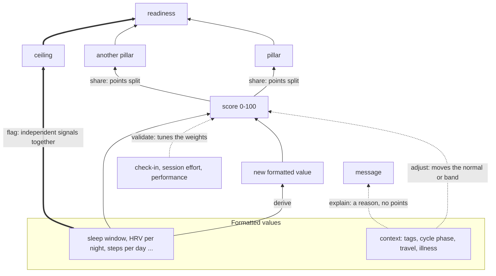

# Metric links: what can combine, and what we can derive

_Written 2026-10-12 at the owner's request, as a companion to
[`scoring-layers-and-data-inputs.md`](scoring-layers-and-data-inputs.md) (the seven layers and the
points model). The owner asked for metrics to be able to affect pillars other than their own,
"same way readiness is affected by any metric", and for "a large well thought out way to establish
what can link together, and what we can derive from that". This is that method, and the first list
of links it produces. Nothing here is built; every number that would change a score is a tuning
proposal for the owner._

## In one minute

- **Readiness is already affected by every metric**: it is the sum of every score's points. What's
  new is letting a metric reach **other scores and other pillars**, without counting anything twice.
- **There are six kinds of link.** Two add information: **derive** (combine values into a new one)
  and **share** (one score counts in two pillars). Two change how a score is read without adding
  points: **adjust** (move a normal or a band) and **explain** (attach a reason). One limits
  readiness: **flag** (a ceiling). One checks the model: **validate** (an outcome the weights are
  tuned against).
- **Readiness counts each piece of information once.** A shared score splits its points between
  pillars and never copies them. Two scores that measure the same thing share one budget. Adjust and
  explain links never add points.
- **Every link passes the same five gates before it counts**: a physiological reason, sources that
  can fill both ends, evidence in the person's own history, no duplicate of an existing score, and a
  replay on past days that the owner signs off.
- **The research behind it covers 30 links.** A few are strong enough to change how a score is read:
  cycle phase, an energy deficit, the rebound after a short night, illness signals in combination,
  the 7-day HRV pattern, and short sleep's cost to the next day's training. Most behaviours (alcohol,
  caffeine, late sessions, stress) only **explain**: their effects already show in HRV, resting HR
  and sleep.
- **A first test on the owner's history** (run privately, numbers kept out of this repo) showed why
  the gates matter. Several links that research expects ran the other way for this person, two heart
  scores turned out to be one signal, and the model as weighted today tracked how the person felt
  less well than its heart scores alone did. Section 7 has the details.

## 1. Where links sit in the seven layers

Links connect the **formatted** layer and everything above it. They never reach into raw data or a
source, so layer rule 1 (no device above the formatted layer) still holds.

## 2. The six kinds of link

| Kind | What it does | Changes points? | Example |
|---|---|---|---|
| **Derive** | Combines two or more formatted values into a new formatted value, which gets its own score | Yes, through the new score | 7-day HRV trend and its stability; illness composite; session load (effort × minutes) |
| **Share** | Lets one score count in more than one pillar | A plain split changes the pillars, not readiness. A share that gives the score extra points changes readiness, and those points come out of the second pillar's other scores | Sleep duration: most of its points in Sleep, some in Activity, because short sleep lowers the next day's training |
| **Adjust** | Moves another score's normal or band | Indirectly: the same value scores differently | Cycle phase moves the temperature normal; a time-zone change pauses the timing normal |
| **Explain** | Attaches a reason to another score's message | Never | "HRV is low; you logged alcohol" |
| **Flag** | Independent signals together set a ceiling on readiness | Caps readiness, never adds | Temperature and breathing both up |
| **Validate** | An outcome the weights are tuned against | Never as an input | Morning fatigue, session effort against plan, illness days |

**Derive** is where most new information comes from. The parts are already measured; the
combination says something none of them does alone. A 7-day HRV average that is falling while its
night-to-night swings grow means more than any one night.

**Share** is how "sleep is affected by more than sleep metrics" works. It comes in two forms.
A **split** moves part of a score's existing points into a second pillar: readiness is unchanged,
but the pillars change, which matters because each pillar is shown to the person and explains the
day. Overnight HRV and resting HR are measured during sleep, so a slice of them can show in Sleep.
A **gain** gives a score extra points in a second pillar because it predicts a second outcome there;
the points come out of that pillar's other scores, so readiness still adds to 100. The best-supported
gain goes outwards from Sleep: a short night lowers the next day's performance by several percent and
makes sessions feel harder, so sleep duration earns some points in Activity as training capacity.

**Adjust** changes what normal means, not how much a score counts. It is only allowed where research
shows the normal itself moves. The luteal phase raises temperature and resting HR, so the normal
should follow. A diet lowers resting HR, so a lower resting HR during a sustained deficit shouldn't
earn a bonus. An adjust link must never excuse a real drop. A lower HRV the night after a hard
session is expected, but the body is still less recovered, and readiness should still fall.

**Explain** gives the score a reason without moving it. Alcohol already shows in HRV, resting HR and
REM. A weight on the alcohol tag would count the same night twice. The tag belongs in the message.

**Flag** is the ceiling from spec section 3.4. Its signals must be independent: two measures of the
same thing count once.

**Validate** is what makes tuning possible (spec section 8). A validation target can never also be
a weighted input, or tuning would just confirm itself. If the morning check-in becomes a score
(spec section 9, item 2), the weights are tuned against something else, such as session effort
against plan.

## 3. Counting each piece of information once

1. **A share never copies points.** A split divides a score's points: if overnight HRV's 10.5
   points are split 7.5 to Heart and 3 to Sleep, it still earns at most 10.5. A gain adds points to
   the score in a second pillar and takes the same number from that pillar's other scores. Either
   way, a pillar's points possible are the sum of what sits in it, and readiness stays out of 100.
2. **Two scores that measure the same thing share one budget.** If two scores move together almost
   perfectly on the person's history (|r| above about 0.8), or are known to be the same physiology,
   their combined points are capped at what one strong score would get. They can become one score,
   or keep both with a reduced total. In the owner's history, overnight HRV and overnight resting HR
   behaved as one signal, yet today they hold 19.5 points between them.
3. **A derived value that is mostly made of an existing score replaces it, or takes its points.**
   The Sleep Regularity Index replaces the timing score. Sleep debt replaces 7-night balance.
4. **Adjust and explain links add no points.**
5. **A flag caps readiness and never subtracts on top of the weighted sum.** The weighted sum
   already includes the scores that raised the flag.
6. **A gain has to predict something different in its second pillar, and links never form a
   loop.** Sleep and next-day mood affect each other, so mood can check the sleep scores but can't
   feed them.

## 4. Five gates a link must pass

| Gate | Question | How it's answered |
|---|---|---|
| 1. Mechanism | Is there a physiological reason, and how strong is the evidence? | A citation, graded strong (meta-analyses or consistent trials), moderate (consistent cohorts or athlete monitoring), weak, or contested |
| 2. Coverage | Can the person's sources fill both ends? | The fill matrix in spec section 6.1. A link no common source can fill waits |
| 3. Personal evidence | Does it show in this person's history, in the expected direction? | A rank correlation within the person, at the link's lag, with each value measured against its own recent normal so slow drift doesn't fake a link (section 7). Nothing is said until there are enough days with and without the cause (10 of each, as a starting proposal) |
| 4. Not a duplicate | Does it add anything the existing scores don't? | Its correlation with every existing score. Above about 0.8, it replaces a score or shares its budget |
| 5. Replay | Does adding it make the score agree better with how days went? | Scored silently, replayed on past days. The proposal states how many days move, and whether agreement with the validation target improves on days held back from the fit. The owner signs off |

Not every kind needs all five:

| Kind | Gates |
|---|---|
| Derive, share | all five |
| Adjust | 1, 2 and 5 (personal evidence is usually too thin to see a shifted normal) |
| Explain | 1 and 2 (no number changes, so the bar is a plausible, sourced reason) |
| Flag | 1, 2, 3 (how often it would have fired, and on which days) and 5 |
| Validate | the target must be answered for real; a pre-filled answer carries nothing |

A personal result can only **block or flag** a link, never prove it. One person over a few months
can show that a link runs the wrong way for them. It can't show a cause, especially when the app's
own advice shapes what they do on a given day.

## 5. The catalogue

Every row's evidence, with its citations and numbers, is in the research note
[`2026-10-12-metric-links-evidence.md`](../reviews/2026-10-12-metric-links-evidence.md) (30 links,
every PubMed ID checked). Grades: **strong** (meta-analyses or consistent trials), **moderate**
(consistent cohorts or athlete monitoring), **weak**, **contested**. "Sources" uses the spec's
section 6.1 columns: **R** ring (direct), **O** Oura API, **H** Health Connect, **A** Apple Health,
**L** the person's own logs.

### Derive: new values from existing ones

| # | Link | Pillar | Lag | Evidence | Sources | Next |
|---|---|---|---|---|---|---|
| D1 | **7-day HRV trend**: the average of ln(RMSSD) over the last 7 nights | Heart | a week | Moderate. Three valid nights a week are enough (Plews 2014) | R O; H partly; A as SDNN | Candidate. It could become the HRV Level, with tonight as the Day term |
| D2 | **HRV stability**: the 7-night coefficient of variation of ln(RMSSD) | Heart | a week | Moderate, but ambiguous alone: it has to be read with D1 (Plews 2012; Flatt 2016, 2017) | R O | With D1 |
| D3 | **Autonomic pattern**: the 7-day HRV and resting-HR trends read together | Heart | a week | Moderate. The pattern beats either alone, and higher HRV isn't always better: overreached athletes show high HRV with low resting HR (Le Meur 2013; Plews 2013) | R O H A | Build first, with one shared budget (section 3) |
| D4 | **Unexplained recovery dip**: how far tonight's HRV falls below what yesterday's logged training predicts | Heart | 1–3 days | Weak to moderate. Expected dips last 24–72 h (Stanley 2013); the slope comes from one new study (Wang 2026) | R O + L | Later; needs session load (D8) |
| D5 | **Illness composite**: temperature, breathing and the autonomic pattern, each counted once | Body, then a flag | can lead symptoms by 1–3 days | Moderate. Sensors plus symptoms beat symptoms alone (Alavi 2022; Quer 2021; Mason 2022) | R O A; H partly | Build for the ceiling |
| D6 | **Sleep Regularity Index**, plus mid-sleep deviation and social jet lag | Sleep | a week | Strong long-term; moderate for next-day mood (Fang 2021); weak for performance | R O H A | Replaces timing (#2823) |
| D7 | **Sleep debt**: the shortfall against the person's need over 14 nights | Sleep | 1–14 nights | Strong that short sleep costs the next day (Craven 2022); the 14-night window is a proposal | R O H A | Replaces 7-night balance |
| D8 | **Session load**: effort (0–10) × minutes, for every session | Activity | per session | Strong, including resistance training (Foster 2001; Day 2004; Haddad 2017) | L, plus any session time | Build, so cardio counts (#2791, #2823) |
| D9 | **Monotony and strain**: weekly load ÷ its day-to-day spread, and weekly load × monotony | Activity | a week | Weak: small samples from one group (Foster 1998) | L | Low-weight context, after D8 |
| D10 | **Energy availability**: (food in − exercise energy) ÷ fat-free mass, over 7 days | Body | a week or more | Strong for long-term harm, weak day to day (IOC REDs statement; Smith 2025) | L, plus DEXA or scale | Feeds the deficit guard (A2) |
| D11 | **Night-time HR dip**: sleeping HR against daytime still HR, as a 30-day median | Heart | a month | Moderate, for long-term health only (Ben-Dov 2007; Johansen 2013) | R A; H partly | Slow context; needs daytime resting HR |
| D12 | **Session end to bed**, in hours, with the session's effort | context | same night | Moderate to strong for hard sessions ending within about 4 h (Leota 2025; Stutz 2019) | L + sleep window | Feeds E3 |
| D13 | **Caffeine dose and hours before bed** | context | same night | Strong (Gardiner 2023 and 2025) | L; A caffeine | Feeds E2 |
| D14 | **Alcohol dose** in g per kg | context | same night | Strong (Pietilä 2018) | L | Feeds E1 and F1 |
| D15 | **Smoothed body weight**: 7-day median or a slow moving average | Body | a week | Strong: daily swings are mostly water and gut content (Cheuvront 2004) | L; scale; H A | Replaces raw daily weight in weight vs plan |

### Share: one score, more than one pillar

A split moves part of a score's points and leaves readiness alone. A gain adds points in the second
pillar, taken from its other scores, and is only allowed where the score predicts a **different
outcome** there (section 3, rules 1 and 6). Neither may form a loop.

| # | Score | Home → also in | Why | Evidence | Next |
|---|---|---|---|---|---|
| S1 | **Sleep duration and sleep debt** (gain) | Sleep → Activity | Short sleep lowers next-day performance and makes sessions feel harder. That is training capacity, an Activity outcome | Strong: performance −7.6%, effort ratings up (Craven 2022; Kong 2025) | First share to build; the size of the gain is a tuning proposal |
| S2 | Overnight HRV and resting HR (split) | Heart → Sleep | Measured during sleep; they show how restorative the night was | Display only | After D3 sets their budget |
| S3 | Breathing rate and SpO₂ (split) | Body → Sleep | Measured during sleep | Display only | Later |
| S4 | Daytime stress (split) | Body → Heart | A daytime autonomic reading, already HR- and HRV-based, so it must not also lower HRV | Display only | Later |

**Not a share: sleep → mood → sleep.** Sleep and next-day mood affect each other (Yap 2020), so mood
is a validation target for sleep scores, never an input to them.

### Adjust: moves a normal or a band

| # | Link | Moves | Evidence | Sources | Next |
|---|---|---|---|---|---|
| A1 | **Cycle phase** | temperature, resting HR, HRV and breathing normals | Strong. Late luteal: about +0.45 °C, +4 bpm, +0.5 breaths a minute, lower HRV (Schmalenberger 2019; Goodale 2019) | H, A cycle types; L | The scorer keeps per-phase normals; the phase input is missing |
| A2 | **Sustained energy deficit (D10)** | withholds resting HR's bonus for being below normal | Moderate. A diet lowers resting HR: −4 bpm after one day, and far more over a long diet (Smith 2025; Isola 2023; Rossow 2013) | L + body composition | Cheap and safe; build early |
| A3 | **A short night before** | withholds the bonus for next night's extra deep + REM and short latency | Strong: that is the expected rebound (Brunner 1990; Borbély 2016) | any sleep source | Cheap and safe; build early |
| A4 | **Smoothed weight (D15)** | weight vs plan reads the trend, not the morning | Strong (Cheuvront 2004; Kreitzman 1992) | L; scale; H A | With weight vs plan |
| A5 | **Time-zone change** | pauses the timing and regularity normals for a few days | Mechanism clear; not researched in depth | the phone's time zone | Candidate |
| A6 | **Planned rest or deload day** | yesterday's movement and load bands | A proposal from the first history test; no study | L (the program) | After item 3 of section 8 |
| A7 | **Age; illness self-report; low wear** | steps floor and HRV yardstick; the day leaves every window | built | profile; L; R wear | Exists |

**Rejected as an adjust:**
- **"Hard training yesterday lowers tonight's HRV normal."** The dip is real lost recovery, and
  readiness should show it. It is an explain link (E6) and, later, the unexplained-dip value (D4).
- **"A hard day raises tonight's sleep need."** No study measured extra need per unit of training;
  the measured gain in deep sleep is about one percentage point (Stutz 2019).

### Explain: a reason, no points

These effects are real, but they already land in HRV, resting HR and sleep, which are scored. A
weight on the cause as well would count the night twice.

| # | Cause | Explains | Evidence |
|---|---|---|---|
| E1 | **Alcohol (D14)** | higher overnight HR, lower HRV, less REM; deep sleep can look better early in the night | Strong. ≤ 0.25, 0.25–0.75 and > 0.75 g/kg: HR +1.4, +4.0, +8.7 bpm; RMSSD −2.0, −5.7, −12.9 ms (Pietilä 2018; Gardiner 2025) |
| E2 | **Caffeine (D13)** | longer latency, shorter and lighter sleep | Strong for sleep, weak for HRV (Gardiner 2023 and 2025) |
| E3 | **Hard session close to bed (D12)** | later sleep, higher resting HR, lower HRV | Moderate to strong; nothing if it ended 4 h or more before sleep (Leota 2025) |
| E4 | **Large meal within 3 h of bed** | night waking, a lower parasympathetic reading | Weak and contested (Chung 2020; Tada 2018; Duan 2021) |
| E5 | **Daytime stress** | longer latency, lower efficiency, lower HRV | Moderate (Hall 2004; Åkerstedt 2007; Yap 2020) |
| E6 | **Hard training yesterday** | lower HRV and higher resting HR for 1–3 days, longer after harder sessions | Moderate to strong (Hynynen 2010; Stanley 2013; Chen 2011 for lifting) |
| E7 | **Melatonin, naps** | slightly faster sleep; less fatigue after a nap | Strong that melatonin's effect is modest (Ferracioli-Oda 2013); naps low certainty (Boukhris 2026) |
| E8 | **Hot nights, light, travel** | more waking, less deep and REM; clock timing | Moderate; only usable if the app learns the temperature or the trip (Chevance 2024; Wams 2017) |

### Flag: independent signals that cap readiness

| # | Flag | Signals (each counted once) | Evidence | Next |
|---|---|---|---|---|
| F1 | **Illness (D5)** | two of temperature, breathing and the autonomic pattern on two nights running, or one plus a symptom. **Downgraded** after alcohol, travel, a late hard session or a hot night, which also set off false alerts | Moderate (Alavi 2022; Quer 2021; Kaulback 2023) | Build with D3 and D5 |
| F2 | **Very short sleep** | 5½ h or less | Strong for next-day performance (Craven 2022) | In the ceiling proposal (spec section 3.4) |
| F3 | **HRV trending down** | tonight below the 10-day mean − 1 SD, or falling two nights running (Kiviniemi 2007), with D1 and D2 confirming | Moderate | After D1 and D2 |

**Not a flag (yet): overreaching.** Load up, efficiency down, fatigue worse and HRV outside its
band in either direction is worth a "lighter week?" message. The evidence is too weak for a ceiling
until it is checked against strength trends.

### Validate: what the weights are tuned against

| # | Target | Evidence | Status |
|---|---|---|---|
| V1 | **Daily check-in, fatigue first**; then soreness, mood, sleep quality | Moderate to strong. Fatigue tracked training load at r = −0.51, against −0.24 for HRV (Thorpe 2015; Saw 2016) | Needs building, and answering (#2823) |
| V2 | **Session effort against plan** (#2791) | Moderate: short sleep raises effort ratings (Kong 2025) | Built; effort is filled on few sessions |
| V3 | **Performance against prescription**: reps and load against what was prescribed | Moderate; one sleepless night barely changes lifting, several short nights do (Knowles 2018) | Prescriptions are stored; not yet compared |
| V4 | **Agreement between the check-in and HRV** | Moderate (Flatt 2018) | A confidence measure once V1 exists |
| V5 | **Illness days, pre-workout energy, mood** | — | Built; illness rarely marked; energy is one item, not the fatigue item |

A realistic expectation: HRV-guided training gives small gains (effect sizes about 0.2–0.4, often
not significant for performance), and no trial has tested it in lifting. Readiness helps by avoiding
bad days, not by adding big performance gains.

### Parked

The research doesn't support these as daily links, so they wait:

- **Steps → that night's sleep.** No consistent day-to-day link (Atoui 2021); regular exercise helps
  sleep over weeks.
- **Protein → next-day soreness.** No effect on soreness (Pearson 2023). Weekly protein stays as
  context.
- **Everyday mild dehydration → HRV.** Only large fluid losses move it (Watso 2020).
- **Monotony → illness as a ceiling.** Weak; D9 stays low-weight context.
- **Overnight settling as a recovery marker.** It is one of today's scores (4.5 points), but no
  peer-reviewed validation was found; it looks like vendor practice. A candidate for fewer points
  in a tuning proposal.

**Common beliefs the research doesn't support:** alcohol helps sleep; evening exercise ruins sleep;
protein cuts soreness; a hard day needs much more deep sleep; higher HRV is always better; a
morning's weight change is fat.

## 6. What we can derive

Every derived value is a formatted value (layer 3), so it gets a normal, a shape and a weight like
any other. Thresholds marked *(proposal)* are not published cut-offs.

| Value | Formula | Needs |
|---|---|---|
| 7-day HRV trend (D1) | mean of ln(RMSSD) over the last 7 nights, with at least 3 valid | nightly RMSSD |
| HRV stability (D2) | 100 × SD ÷ mean of the same ln(RMSSD) values | nightly RMSSD |
| Autonomic pattern (D3) | the 7-day HRV and resting-HR trends, each against its 60-day normal *(proposal)*: HRV down and HR up = load or illness; HRV up and HR down with fatigue normal = adapting; HRV up and HR down with fatigue worse = possible overreaching | nightly HRV and resting HR |
| Unexplained recovery dip (D4) | tonight's ln(RMSSD) against normal, minus β × (yesterday's load − usual load), with β learned per person; one new study gives a starting β | D1, D8 |
| Illness composite (D5) | the number of channels at least 2 steps the bad way *(proposal)*: temperature (against the cycle-phase normal), breathing, the autonomic pattern | the nightly values |
| Regularity (D6) | Sleep Regularity Index; mid-sleep deviation from its 28-day median; social jet lag (free-day minus workday mid-sleep) | sleep windows |
| Sleep debt (D7) | the sum over 14 nights of the shortfall below need, counting only shortfalls *(proposal)* | sleep duration |
| Session load (D8) | effort (0–10) × minutes, summed per day, with rest days as 0 | session effort and duration |
| Monotony and strain (D9) | weekly mean daily load ÷ its SD (capped when the SD is near 0); strain = weekly load × monotony; judged against the person's own history | D8 |
| Energy availability (D10) | the 7-day mean of (energy in − exercise energy) ÷ fat-free mass; below 30 kcal per kg of fat-free mass is low (a threshold set in women; men's is unclear) | food log, session energy, body composition |
| Night-time HR dip (D11) | 100 × (daytime still HR − sleeping HR) ÷ daytime still HR, as a 30-day median; under 10% is "non-dipping" | daytime and sleeping HR |
| Session end to bed (D12) | sleep onset − session end, in hours; "late hard" when under 4 h with effort 7 or more *(proposal)* | session end, effort, sleep window |
| Caffeine (D13) | dose and hours before bed, against the meta-analysis cut-offs: about 100 mg within 9 h, 200 mg within 13 h, 400 mg within 12 h | supplement log, sleep window |
| Alcohol (D14) | drinks × grams per drink ÷ body mass, in the bands ≤ 0.25, 0.25–0.75, > 0.75 g/kg | tag with a count, body mass |
| Smoothed weight (D15) | 7-day median, ignoring daily moves under about 1% | scale or logs |

## 7. Testing links on history

The first test ran on 2026-10-12 against about four months of the owner's stored history,
read-only, in a private sandbox. The results are the owner's health data, so they are in a private
report, not here. This section keeps the method and what it taught about the method.

**How it ran.**

- Every input was read from the owner-scoped read-only views. The days were scored by the production
  scorer (`prepareShadowHistory → assembleShadowInputs → scoreShadowReadiness`) with no changes.
  The scores matched production's stored shadow rows unit for unit on the days both had.
- The validation target was the pre-workout energy rating, the only daily self-report that is
  actually answered. The morning check-in's recovery answer stays at its pre-filled value, so it
  carries nothing (spec section 8).
- Each link was a Spearman rank correlation at its natural lag (yesterday → last night, last night →
  today, or the same night). Every value was measured against the median of its own previous 30 days
  first. The links were chosen in advance, and the results were corrected for testing them all at
  once (Benjamini–Hochberg).

**What it taught.**

1. **Remove slow drift first.** The energy rating drifted over the months. Before both sides were
   measured against their own recent normal, several links looked strong, and they vanished once
   the drift was removed. Any future test must do the same.
2. **Some links that research expects ran the other way for this person.** Gate 3 exists for
   exactly this. The cause can't be read off, because the app's readiness advice shapes when the
   person trains.
3. **Two heart scores were one signal**, which is the duplicate gate's job (section 3, rule 2). It
   also matters for the flag: counted as two signals, overnight HRV and resting HR tripped a test
   illness ceiling on several ordinary nights; counted once, almost never.
4. **Movement scored as "more is better" ran against how the person felt.** Yesterday's steps, and
   the Activity pillar built on them, went with lower energy the next day. For a person who lifts,
   yesterday's activity may be better scored as load (a cost still being paid) than as an
   achievement. That is a tuning proposal, not a finding about everyone.
5. **The weights need a real validation target before they can be tuned.** The model as weighted
   today tracked the energy rating less well than its heart scores did on their own. No set of
   weights should be fitted to one person's four months, but the direction is clear: weights should
   be tested against an honest daily check-in, as spec section 8 says.
6. **Missing inputs limit what can be tested.** Set-level HR recovery reads empty (#2824). Fuel never
   scored, because no day is marked fully logged. Training load is withheld for 28 days after a
   program starts. Normals don't yet restart when the source changes (#2825).

## 8. What to build first

In order. Each item is a card (spec section 7.1) before any code, and anything that moves a score is
a `type: tuning` proposal.

1. **An honest daily check-in**, fatigue first, then soreness, mood and sleep quality, answered
   rather than pre-filled. Without a validation target no link can pass gate 5 (#2823).
2. **HRV and resting HR read as one pattern (D3), with one budget.** It fixes the double count, the
   flag needs it, and it catches the "high HRV isn't always good" case.
3. **The two cheap guards**: no resting-HR bonus during a sustained deficit (A2), and no bonus for
   the expected deep-sleep rebound after a short night (A3). Both only ever remove a bonus the
   research says is false.
4. **Activity as load, and sleep's share into Activity (S1).** Score yesterday's movement and
   training as a cost, or within a band, rather than "more is better", and let short sleep lower
   training capacity. Replay both against the check-in.
5. **The derived values with the strongest evidence and full coverage**: the illness composite with
   its downgrades (D5, F1), the 7-day HRV trend and stability (D1, D2), regularity (D6), and session
   load (D8) so cardio counts.
6. **Explain links for what people already log**: alcohol, caffeine, late hard sessions, late meals.
   They change no points, so gates 1 and 2 are enough.
7. **Cycle phase (A1).** The scorer already keeps per-phase normals; only the phase input is missing.
8. **Splits last (S2–S4).** They change only what each pillar shows.

Alongside these, a tuning proposal should revisit **overnight settling's 4.5 points**, since no
peer-reviewed validation was found for it.

## 9. Open decisions for the owner

- **Pillar totals with splits.** A split moves points between pillars. The recommendation is to let
  pillar totals float with their splits, so readiness stays out of 100 and each pillar shows what
  really sits in it. The alternative keeps 30/30/20/20 fixed and makes every split take points from
  the receiving pillar's other scores, which is harder to follow.
- **How large the shared HRV + resting HR budget is**, or whether they become one score.
- **Whether yesterday's activity counts as load or as achievement.**
- **Which outcome the weights are tuned against** until a daily check-in exists.
- **How many points sleep gains in Activity** (S1).
- **Whether overnight settling keeps its 4.5 points.**

## 10. Read next

- [`scoring-layers-and-data-inputs.md`](scoring-layers-and-data-inputs.md): the layers, the points
  model, the sources and the metric card.
- [`2026-10-12-metric-links-evidence.md`](../reviews/2026-10-12-metric-links-evidence.md): the
  research behind every link.
- [`2026-10-12-readiness-metric-evidence.md`](../reviews/2026-10-12-readiness-metric-evidence.md):
  the research behind the candidate metrics (#2823).
- [`readiness-tree.md`](readiness-tree.md): the design of the shadow model.
- [`2026-10-12-data-gaps-summary.md`](../reviews/2026-10-12-data-gaps-summary.md): what we collect,
  what we use, the gaps, and new metrics built from data we already have.
