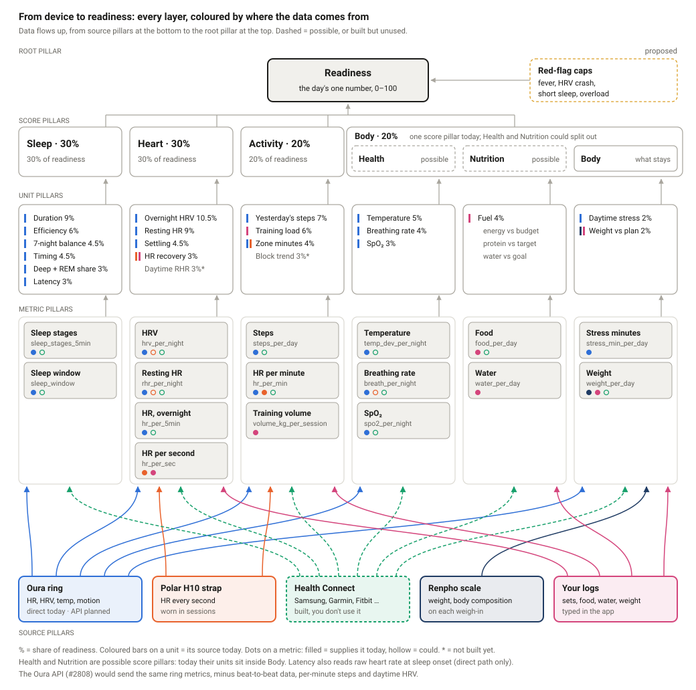
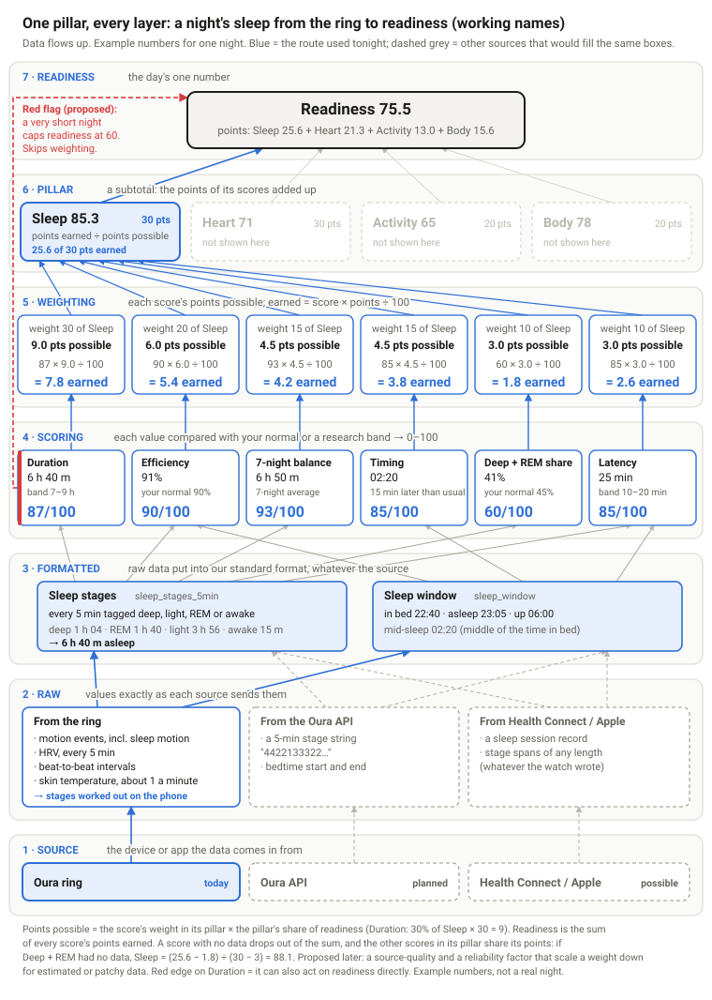

# Scoring layers and data inputs

_Written 2026-10-11 for jsboiss, who is leading the move to a native app, and updated 2026-10-12
with the scoring model the owner agreed. It describes `main` as of `0e2df9995d`: how a score is
built, where every piece of data comes from, what each source can and cannot give, how a new metric
is added and tuned, what a native app has to keep, and how work moves through the repo. Each section
links to the deeper doc._

## In one minute

- **Every number sits on one of seven layers**, bottom to top: source → raw → formatted → scoring →
  weighting → pillar → readiness. The owner agreed the layers and their order on 2026-10-12; the
  names are working names. Devices plug in only at the bottom, and nothing above the formatted layer
  knows which device a value came from.
- **Every score is 0–100, and its weight is the points it can add to readiness.** Duration is worth
  9 points, overnight HRV 10.5. A score earns `score × points ÷ 100`, and readiness is the sum of
  what every score earns.
- **A score with no data drops out of the sum**, and the other scores in its pillar share its
  points. Nothing is ever filled in or counted as zero, so nobody is penalised for not owning a
  device.
- **The goal is many more metrics**, each scored against research and the person's own normal, and
  each tuned against a measure of how the person actually felt and trained. Section 7 is the recipe
  for adding one, section 9 the candidates.
- **A few scores can act on readiness directly.** Duration, overnight HRV, resting HR, training load,
  temperature and breathing rate can move readiness past their weight: through the illness check
  today, and through proposed ceilings in the new model.
- **The only supported runtime is the APK on the owner's Samsung S25 Ultra**: a Capacitor WebView
  that loads the Next.js app from Railway, plus about 6,200 lines of Kotlin for Bluetooth and
  background services.
- **Device data is server-first and typed data is device-first.** Ring frames go up to the server,
  the server turns them into nightly and daily rows, and the phone pulls those back. Anything a user
  types is written to on-phone SQLite first and synced up through an outbox.
- **One user has the full data set.** The direct Oura ring pipeline is owner-only. The multi-user
  routes are Health Connect, which is built but has never run against real data, the Oura API,
  which is planned (#2808), and Apple Health, which would come with a native iPhone app.
- **Changes are paused** while the native work is under way: agents do read-only analysis and docs
  only, and nothing is released until the owner lifts the pause.



_Every score pillar expands into its scores, every score into the formatted values it reads, every
formatted value into the raw shapes that can fill it (purple cards), and every raw shape into the
sources that can send it. A filled source pill sends it today; a dashed one is planned or possible.
Red marks the scores that can act on readiness directly. Health and Nutrition are possible pillars
that don't exist yet: today their scores sit inside Body._

## 1. The seven layers

The owner agreed these on 2026-10-12, working up from the device. The names are working names until
the owner chooses final ones (#2809).

| # | Layer | What you see there | Example: one night | What today's code calls it |
|---|---|---|---|---|
| 1 | **Source** | The device or app the data comes in from | Oura ring | source, route |
| 2 | **Raw** | Values exactly as the source sends them: their shape and how often | HRV every 5 min while asleep: 44, 52, 47, 50 … ms | the raw tables (`oura_raw_*`, `rr_intervals`, Health Connect records) |
| 3 | **Formatted** | Raw data put into our standard format, whatever the source | `hrv_per_night` = 48 ms | Input (the input cascade) |
| 4 | **Scoring** | Each formatted value turned into 0–100, against research and the person's normal | Overnight HRV 75/100 (a night at a 48 ms normal) | Unit |
| 5 | **Weighting** | Each score's points possible, and the points it earns | 10.5 possible × 75% = 7.9 earned | the unit and pillar weights |
| 6 | **Pillar** | A subtotal of the points in one area | Heart 71 → 21.3 of 30 points | Pillar |
| 7 | **Readiness** | The sum of every score's points | 75.5 | Readiness |

**Rules that come with the layers:**

1. **A source never appears above the formatted layer.** Scoring never reads a device. This is the
   line every device, vendor API and future integration plugs into.
2. A formatted value's id says its cadence: `hr_per_min`, `hrv_per_night`, `steps_per_day`.
3. Raw and formatted values carry measurement units (bpm, ms, °C, minutes). From the scoring layer
   up, everything is on the same 0–100 or points scale.
4. A raw shape can feed several formatted values (beat-to-beat intervals feed HRV, breathing rate
   and the sleep stager), and a formatted value can be filled by several raw shapes; the best one
   available wins (section 5).
5. **A vendor's numbers are generic formatted values; a vendor's scores are never ours** (owner,
   2026-10-18, #2860). Oura's readiness is not our readiness, and its sleep score is not our Sleep
   pillar.
   - A vendor's values are taken as the vendor calculated them, each under its own name and
     source: HRV, resting HR, temperature deviation, breathing rate, stage durations, efficiency,
     latency, MET, stress minutes. We don't recompute them from the vendor's series.
   - A vendor's sub-scores are inputs only where the vendor sends no underlying value. Oura's
     recovery index is the main case.
   - A vendor's top-level scores (Oura's readiness, sleep, activity and resilience) are never
     inputs. For now they are the tuning reference: our pillars are compared with them daily and
     fitted to show what the vendor weights (#2986). A weight change that comes out of that is a
     `type: tuning` proposal like any other.

The 2026-10-11 version of this doc used five layers (root, score, unit, metric, source). Raw is new,
"metric" became formatted, "unit" became scoring, weighting is now its own layer, "score" became
pillar and root became readiness. In this doc, "a score" means what the code calls a unit. The code
still says Pillar, Unit and Input; nothing is renamed until the names are final.



_One example night through all seven layers for the Sleep pillar. The numbers are illustrative, not
anyone's real data._

## 2. Scoring: how a value becomes 0–100

This section describes the **shadow model** (`packages/shared/src/health/shadow-readiness/`,
version 3). It is scored every day alongside the live readiness, shown nowhere yet, and is the model
the app is moving to. The design is in [`readiness-tree.md`](readiness-tree.md).

### 2.1 Three shapes

| Shape | 100 when | Falls when | Used by |
|---|---|---|---|
| **Sweet spot** | inside a band (e.g. 7–9 h) | below or above it, each side at its own rate | duration, 7-night balance, latency, steps, training load, zone minutes, SpO₂, fuel |
| **Steady** | at the person's normal (or, for weight, the plan's pace) | it drifts either way | timing, deep + REM share, temperature, breathing, weight vs plan |
| **Directional** | well past the normal in the good direction | it moves the bad way | efficiency, HRV, resting HR, settling, HR recovery, daytime stress |

A steady or directional score is `clamp(Level + Day, 0, 100)`. Weight vs plan is the one exception:
it is scored on a fixed band around the plan's pace, with no Level.

- **Level** is the person's *normal*, graded against a research yardstick. An HRV normal of 45 ms
  grades 74. Where there's no yardstick, Level is 70 for a directional score and 100 for a steady
  one.
- **Day** is today against that normal: 20 points per step. A directional score moves from +30 down
  to −70; a steady score only loses points, whichever way it moves.

### 2.2 How a person's normal is learned

- **Normal:** the median of the valid days within the last 30 calendar days, with at least 7 needed.
- **Step:** how much the value usually moves night to night, the interquartile range ÷ 1.349, never
  smaller than the smallest change that means anything (3 ms of HRV, 2 bpm of resting HR, 0.15 °C,
  2 points of efficiency, 20 min of timing).
- **Maturity:** days 0–13 are learning (Level only, or the score drops out), 14–29 provisional, and
  30 on settled. A new score counts at half weight until it settles.
- **A lasting change** rebuilds the normal: the last 7 valid days all sit on one side of the old
  median, their own median is at least 1.5 steps away from it, and the window holds at least 14 days.
- **Normals are per device (#2984).** The scorer restarts a normal when the source changes, and
  since #2984 the nightly HRV, resting HR and sleep series carry the device that measured them, and
  temperature and breathing take Oura's own value where the ring summary has none for the night. An
  `oura_cloud` night is judged against `oura_cloud` nights, never the ring's. Live readiness follows
  the same rule (`lib/health/readiness-night-inputs.ts`).

### 2.3 Worked examples

These use made-up numbers to show the arithmetic.

**Duration: the research band and the person's own band together.** The research band is 7–9 h,
and it acts as a guardrail. Inside it the app builds the person's own band: as wide as their nights
usually vary (between 1 and 2 hours), centred on their typical night, and never allowed outside
7–9 h. Someone whose nights vary over 1.5 h with a typical night of 7 h 20 m would get 6 h 35 m–8 h
05 m, which the guardrail pushes up to **7.0–8.5 h**. Anything inside scores 100; below it the
score falls 40 points an hour, so 6 h scores 60 and 5 h scores 20.

**Efficiency: directional.** A normal of 90% grades 85 on the research yardstick (75% → 40,
85% → 70, 95% → 100). If this person's efficiency usually moves about 4 points night to night, one
step is 4 points. A night at 85% is 5 below the normal, 1.25 steps, which costs 25: **85 − 25 = 60**.
A very consistent sleeper has a small step, so a small dip costs a lot; that is a tuning lever.

**Timing: steady.** Timing is mid-sleep, the halfway point of the sleep window: from the window's
start (going to bed, so it includes the time taken to fall asleep) to waking. It measures how
regular the body clock is. In bed 00:30 → up 08:30 puts mid-sleep at 04:30. Against a usual 03:45 that moves about 25 minutes night to night, 45 minutes
late is 1.8 steps: **100 − 36 = 64**.

**Temperature: steady.** 100 at the person's normal, and 20 points off for every step either way.
For someone whose step is the 0.15 °C floor, a night 0.35 °C above normal is about 2.3 steps:
**53**. Its weight is only 5 points of readiness, which is why a fever is handled as a red flag
(section 3.4).

**HRV: directional.** A normal of 48 ms grades 75 on the population range (HRV is
largely genetic, so the range only spans 60–90). Each step above the normal adds 20, capped at +30,
so an unusually high night can't run away with the score; each step below costs 20, down to −70.
Making a very high night cost points too, as overreaching sometimes shows, would be a tuning
decision.

## 3. Weighting: points possible, and how readiness adds up

### 3.1 Every score's weight is the points it can add

| Pillar (points) | Scores and their points possible |
|---|---|
| Sleep (30) | duration 9 · efficiency 6 · 7-night balance 4.5 · timing 4.5 · deep + REM share 3 · latency 3 |
| Heart (30) | overnight HRV 10.5 · overnight resting HR 9 · settling 4.5 · HR recovery 3 · daytime resting HR 3 (not built) |
| Activity (20) | yesterday's steps 7 · training load 6 · zone minutes 4 · block trend 3 (not built) |
| Body (20) | temperature 5 · breathing rate 4 · fuel 4 · SpO₂ 3 · daytime stress 2 · weight vs plan 2 |

A score's points possible is its weight inside its pillar times the pillar's share of readiness:
duration is 30% of Sleep, and Sleep is 30 points, so duration is worth 9. The code stores the two
numbers separately (`UNIT_DEFS[...].weight` and `PILLAR_WEIGHTS` in
`shadow-readiness/model.ts`); points possible is their product ÷ 100 (30 × 30 ÷ 100 = 9).

- **Points earned** = score × points possible ÷ 100.
- **Points lost** = points possible − points earned.
- **Readiness** = the sum of every score's points earned.

### 3.2 A worked night

The Sleep pillar from the diagram above:

| Metric | Score | Points possible | Earned |
|---|---|---|---|
| Duration | 87 | 9.0 | 7.8 |
| Efficiency | 90 | 6.0 | 5.4 |
| 7-night balance | 93 | 4.5 | 4.2 |
| Timing | 85 | 4.5 | 3.8 |
| Deep + REM share | 60 | 3.0 | 1.8 |
| Latency | 85 | 3.0 | 2.6 |
| **Sleep** | **85.3** | **30** | **25.6** |

With Heart, Activity and Body earning 21.3, 13.0 and 15.6, readiness is 25.6 + 21.3 + 13.0 + 15.6
= **75.5** (the code keeps one decimal). Every score shows what it adds and what it costs, which is where tuning happens.

### 3.3 When a score has no data

A score with no data leaves the sum entirely: its points earned and its points possible both drop
out, and **the other scores in the same pillar share its points**. The pillar keeps its share of
readiness, so Sleep still counts for 30 points for someone whose device has no sleep stages.

If deep + REM share had no data in the night above, Sleep would be the points earned without it
over the points possible without it: (25.6 − 1.8) ÷ (30 − 3) × 100 = **88.1**. Dividing by 100 instead would count the missing score as zero and penalise
the person for their device; the model never does that. A pillar with no scores at all drops out,
and the other pillars share its points.

Today daytime resting HR and block trend aren't built, so their points are always shared by the rest
of Heart and Activity. HR recovery is new, so it counts at half weight until its normal settles.

**Proposed, not built:** two more factors that scale a weight down: **source quality** (an estimated
value, such as stages from the phone's stager, counts less than a measured one) and **reliability**
(a score that has been patchy lately counts less until it shows up most nights). Both would keep
missing data at zero weight.

### 3.4 Red flags set a ceiling on readiness

A weight can only move readiness by that score's share, and the share shrinks as metrics are added:
with 15 sleep metrics, each is worth only a few points. So a weight can never carry a fever. A red
flag instead sets a **ceiling**: readiness is the lower of the weighted sum and the ceiling. Scoring
stays the same; only the final number is limited.

The owner also looked at doing this in the weighting layer, with an alarm multiplier that grows a
score's weight when it's alarming. That works for a fixed set of metrics, but it has to be retuned
every time a metric is added, and it can't guarantee how low readiness goes. A ceiling doesn't
depend on how many metrics there are. On 2026-10-12 the owner leaned towards the ceiling; its exact
form and numbers are a tuning decision.

**Proposed: graded.** For example, temperature +0.3 °C above normal sets a ceiling of 80, +0.5 °C
sets 60 and +0.7 °C sets 40, with the ceiling interpolated between those points, so 37.9 °C and
38.0 °C land a few points apart. When
several flags fire, the lowest ceiling applies, and the proposal could lower it further when flags
stack. The numbers below are today's proposal:

| Score | Red flag | Live readiness today | Shadow model (proposed ceiling) |
|---|---|---|---|
| Temperature | Fever, illness | Illness check: −25 for fever, −10 when "elevated" | Fever: 40; illness signs: 60 |
| Breathing rate | Illness | Part of the illness check | Illness signs: 60 |
| Resting HR | Illness | Part of the illness check | Illness signs: 60 |
| Overnight HRV | HRV crash, illness | Part of the illness check | HRV score at 20 or below: 60 |
| Duration | Very short sleep | — | 5½ h or less: 60 |
| Training load | Overload | — | Load ratio 1.6 or more: 65 |

The illness check weighs how far temperature (40%), breathing (25%), resting HR (20%) and HRV (15%)
sit from normal, the bad way. On the owner's history so far it has rarely fired, and only at
its lowest level, "watch". Before any ceiling counts, the cycle-aware normals in section 9 matter: a luteal-phase rise
in temperature and resting HR is as large as an illness flag.

### 3.5 The live model it replaces

The **live readiness** users see today (`lib/health/readiness-payload.ts`) is older. It has 8
contributors copied from Oura's layout, counts HRV and heart rate twice, and applies a flat illness
penalty of −10 or −25. It reads about 20 fields straight from the Oura tables (`oura_daily`,
`oura_daily_summary`, `oura_daily_derived`), which is exactly what the layers forbid.

**The shadow model isn't fully device-blind either.** Only overnight HRV and overnight resting HR
go through the input cascade in full; HR recovery uses its adapter but skips the cascade's
plausibility check (section 5). Settling, temperature and breathing read
`oura_daily_summary`, and daytime stress reads `oura_daily_derived`
(`shadow-readiness/assemble.ts`). Those reads are what a connector has to replace before a second
device brand can score.

## 4. Where data comes from today

| Source | What it sends | How it gets in | Where it lands first | How often | Who can use it |
|---|---|---|---|---|---|
| **Oura ring, direct** | Raw frames: beat-to-beat HR, HRV every 5 min, skin temperature about once a minute, motion, SpO₂ ratio | Native foreground service `OuraRingService.kt` drains the ring over BLE and POSTs to `/api/oura-ble/samples` | Phone: `oura_raw.db`. Server: `oura_raw_samples` (7-day hot window), packed into `oura_raw_packed` | On connect, then hourly (median gap 62 min) | **Owner only**: admin-only route, the owner's ring key |
| **Polar H10 strap** | HR about once a second, plus RR intervals | Native `PolarStrapService.kt` → `/api/hr-ingest` | Server only: `oura_heartrate` (source `chest_strap`), `rr_intervals` | 1 Hz in workouts; one sample per 30 s all day | Anyone with a strap |
| **Renpho scale** | Weight and impedance; body composition is our own estimate | Native `ScaleBleService.kt` → `/api/scale-ble/samples` | Server: `scale_raw_samples`, then accepted readings go to `body_metrics` | Each weigh-in | Anyone with the scale |
| **Health Connect** | Whatever Samsung, Garmin, Fitbit and others write: sleep, HR, HRV, SpO₂, steps, weight, nutrition | JS plugin (`lib/health-connect-sync.ts`) when the app opens → `/api/sync-health` | Server: `body_metrics`, `sleep_sessions`, `activity_logs`, `oura_heartrate`, `health_connect_intervals` | On app open: 30 days back the first time, 7 days after that | Any user in principle; never run on real data |
| **Colmi ring** | HR, SpO₂, temperature, sleep | WebView BLE (`lib/colmi-ble/`) → `/api/colmi/samples` | Server: isolated `colmi_*` tables | Every 30 min | Comparison only, never scored |
| **Phone GPS** | Routes for walks and runs you start | Background-geolocation plugin | Phone: `activity_logs`, then the outbox | 5 m distance filter | Anyone |
| **Your logs** | Sets and workouts, food, water, weight, check-ins, sleep entered by hand | App screens | Phone SQLite, then the outbox → `/api/sync/push` | As typed | Anyone |
| **Oura API** (#2808) | Oura's own nightly and daily values, HR every 5 min | Not built | — | After the Oura phone app syncs | Up to 10 users until Oura approves the app |

**Where the data is true.** The rule is in
[`offline-first-and-storage.md`](../rules/offline-first-and-storage.md):

- **Typed data is device-first.** Everything in `SYNCED_MUTATION_DOMAINS`
  (`packages/shared/src/sync/mutation-schema.ts`) is written to the on-phone store and the outbox
  together, read back locally, and deleted with a `deleted_at` tombstone. A server hard delete never
  reaches a phone that hasn't synced.
- **Device data is server-first.** The ring rollup (`lib/oura-ble/rollup/run.ts`) runs only on the
  server. It writes `oura_heartrate`, `sleep_sessions`, `body_metrics` and the `oura_daily*` tables,
  and the phone pulls those through `/api/sync/pull`: a 90-day window, 500 rows a page, at most every
  5 minutes.
- **When two sources write the same field**, `mergeSet` keeps the higher rank:
  manual > scale > ring (BLE) > ring (old Cloud rows) > Health Connect
  (`packages/shared/src/health/source-rank.ts`).

## 5. The formatted layer and the input cascade

The input cascade (`packages/shared/src/inputs/cascade.ts`) is the start of the formatted layer.
Its routes are the raw layer: for each formatted value it lists the raw shapes that can fill it. It
names six formatted values today: `steps/min`, `MET/min`, `HR/min`, `HRR60`, `HRV/night` and `RHR/night`.
For each one it:

- tries routes in rank order: **provided** by a device, then **derived** from other data, then
  **estimated**;
- returns `null` when nothing qualifies, never 0;
- tags every value with its provenance: route, rung, source, and low-wear or capped flags;
- drops implausible values instead of clamping them, and can keep baselines per source
  (`baselineValues`), which the shadow model doesn't call yet (#2825).

**Where it's wired:** training stress reads `steps/min` and `MET/min`; the shadow model reads
`HRV/night` and `RHR/night`, and takes `HRR60` from the adapter without `resolveSlots`. **Where it isn't:** the live readiness, Sleep and Activity
scores. `HR/min` is defined but nothing resolves it in production; heart-rate merging happens at
read time in `mergeHrSources`.

**The catalogue still needs** sleep stages, sleep window, nightly temperature deviation, nightly
breathing rate, nightly SpO₂, wear time, and daily steps for sources with no per-minute count.

**The connector itself is design only.** [`data-source-connector-guide.md`](../data-source-connector-guide.md)
§10 describes a `DataSourceConnector` record (what a source supplies, how it ingests, backfills and
is ranked), and [`ingest-and-scoring.md`](ingest-and-scoring.md) describes a connector → normaliser
→ store pipeline. Neither is built. Today each source is a hand-written integration.

## 6. What else each source can provide

Researched 2026-10-12, from the pinned Oura OpenAPI spec (`.claude/skills/oura-api/references/openapi-v1.34.json`),
the pinned Health Connect plugin and SDK (`@devmaxime/capacitor-health-connect` 1.1.0 on
`connect-client` 1.1.0-alpha11), and Apple's HealthKit documentation. Nothing was run on a device,
so sample densities are what the vendors document, not measured. **Vendor top-level scores are
never inputs** (rule 5 in section 1): Oura's readiness, sleep and activity scores, resilience and
cardiovascular age, and Apple's Readiness and Sleep Score are a comparison and tuning reference.
We compute our own. A vendor's calculated values, and its sub-scores where it sends no underlying
value, are generic inputs.

### 6.1 Which formatted values each source can fill

✅ fills it · ◐ partly, or only with a caveat · ❌ cannot · Ring = the direct Oura ring today.

| Formatted value | Ring (direct) | Oura API | Health Connect | Apple Health |
|---|---|---|---|---|
| `sleep_window` | ✅ | ✅ sleep periods | ✅ sleep session | ✅ `sleepAnalysis` |
| `sleep_stages_5min` | ✅ our stager | ✅ `sleep_phase_5_min` (also 30-s) | ◐ if the writer sends stages; "awake in bed" is lost | ✅ core, deep, REM; no awake before sleep, so **latency can't be scored** |
| `hrv_per_night` | ✅ RMSSD every 5 min | ✅ `average_hrv` and a sleep HRV series (unit not in the spec) | ◐ RMSSD spot readings, any cadence | ◐ **SDNN** every ~4 h while still; RMSSD only by computing it from the stored heartbeat series. iOS 27 adds an RMSSD type, behaviour unknown |
| `rhr_per_night` | ✅ | ✅ `lowest_heart_rate` | ◐ the writer's own "resting HR", often a daytime value | ❌ Apple's resting HR **excludes sleep**; derive it from overnight HR samples |
| `hr_per_5min` (overnight) | ✅ | ✅ sleep HR series, `heartrate` route | ◐ depends on the writer | ✅ one sample per 5 min while still |
| `hr_per_min` | ✅ | ❌ 5-min only | ◐ depends on the writer | ◐ workouts only (every 5 s); 5-min at rest |
| `hr_per_sec` | ❌ (strap ✅) | ❌ | ◐ only a writer that records about 1 Hz | ◐ workouts only |
| beat-to-beat intervals | ✅ IBI (strap ✅ RR) | ❌ | ❌ | ◐ short tachograms, every ~4 h |
| `steps_per_day` | ✅ | ✅ (days run 4 a.m. to 4 a.m.) | ✅ | ✅ |
| `met_per_min` | ✅ | ◐ `met` series, interval not in the spec | ◐ derived from active calories + weight, or cadence | ◐ `physicalEffort`, density unknown |
| `temp_dev_per_night` | ✅ | ✅ `temperature_deviation` | ◐ skin-temperature deltas; needs a converter and an APK | ✅ one absolute value a night (Series 8+); we compute the deviation |
| `breath_per_night` | ✅ | ✅ `average_breath` | ◐ readings with no sleep flag; needs a converter | ✅ recorded during sleep |
| `spo2_per_night` | ✅ uncalibrated | ✅ calibrated nightly average | ◐ readings with no sleep flag | ◐ periodic, Series 6+, not SE |
| `stress_min_per_day` | ✅ our model | ✅ `stress_high` (seconds) | ❌ no stress type | ❌ no stress type |
| `food_per_day`, `water_per_day` | — | ❌ | ✅ nutrition, hydration (hydration needs a converter) | ✅ dietary types, if an app writes them |
| `weight_per_day` | — | ❌ one undated profile value | ✅ | ✅ |
| `volume_kg_per_session` | — | ❌ | ❌ (set weight arrives in a newer SDK, if the writer fills it) | ❌ no sets or load |

**What it means for the pillars:**

- **Sleep** works on every source. Latency is the weak spot: Apple can't show when someone fell
  asleep, and Health Connect only when the writer sends awake stages.
- **Heart** is strongest on the ring. The Oura API keeps nightly HRV and resting HR but loses
  per-minute HR, so **HR recovery after sets needs a strap** on every source but the ring. Apple's
  HRV is a different statistic (SDNN) and has to keep its own normal; its resting HR fills the
  **daytime** resting HR score, not the overnight one.
- **Activity** works on every source for steps. Zone minutes need per-minute HR, which the Oura API
  can't give.
- **Body** works on every source for temperature, breathing and SpO₂, with caveats. **Daytime
  stress is Oura-only** (ring or API); Health Connect and Apple have no stress type.

### 6.2 New metrics the sources make possible

| New metric | From | Pillar | Can it learn a personal normal? |
|---|---|---|---|
| Breathing disturbances during sleep | Ring (sleep model output), Oura API `breathing_disturbance_index`, Apple `appleSleepingBreathingDisturbances` | Body or Sleep | Yes, nightly; best as a 30-day trend and a red flag |
| Restlessness | Oura API `restless_periods`, 30-s movement | Sleep | Yes |
| Wear time | Oura API `non_wear_time`, 5-min activity class; ring wear time | a gate for every pillar | — |
| Daytime resting HR | Apple `restingHeartRate`, Oura API session HR, ring | Heart (fills the unbuilt score) | Yes |
| Walking HR | Apple `walkingHeartRateAverage` | Heart | Yes |
| Cardio recovery after a workout | Apple `heartRateRecoveryOneMinute` | Heart (next to HR recovery after sets) | Yes, per workout |
| VO₂ max | Oura API `vo2_max`, Health Connect `Vo2Max`, Apple `vo2Max` | Activity (slow trend, block trend) | Yes, as a slow trend only |
| Cardio sessions and their effort | Oura API workouts, Health Connect exercise sessions, Apple workouts and effort scores | Activity: training load that counts more than lifting | Yes |
| Moderate and vigorous minutes | Health Connect `ActivityIntensity` (newer SDK), Apple exercise minutes | Activity: zone minutes without dense HR | target-based |
| Energy out | Oura API calories, Health Connect total calories, Apple active + basal energy | Body: fuel's energy balance | Yes |
| Body composition | Health Connect, Apple, our scale | Body | Yes, as a trend |
| Cycle phase | Health Connect and Apple cycle types | context: splits the temperature, breathing, HRV and resting-HR normals | — |
| Mood, mindfulness, caffeine, time in daylight | Apple State of Mind, mindful sessions, caffeine, daylight; Health Connect mindfulness | context, or a future wellness score (section 9) | mood yes; the rest are behaviours |

### 6.3 Defects found along the way

These were found while reading the code for this section, and each is filed:

- **Health Connect distance is never granted**, so distance comes back empty, and the daily
  total-calories value is read on the phone but dropped by `/api/sync-health` (#2818).
- **Health Connect HRV and SpO₂ are averaged over a fixed 00:00–08:00 clock window**, not the sleep
  session (#2819).
- **The Apple Health plan maps Apple's resting HR onto overnight resting HR**, which mixes two
  definitions (`docs/superpowers/plans/2026-09-14-apple-healthkit-ios-connector.md`, #2821).
- **The Oura API skill notes disagree with the pinned spec** in places #2808 would build on:
  heart-rate cadence, webhook payload and signature, and scope names (#2820).

## 7. Adding a metric

The owner's goal is as many metrics as the sources allow, all scored against research and the
person's own normal. How metrics combine across pillars (derived values, shares, adjusts and the rest) is
in [`metric-links.md`](metric-links.md). The layers make that cheap: a new metric needs a raw route, a formatted value,
a 0–100 rule and a weight, and nothing above it changes. The weighted sum handles it whether its data
is there or not.

### 7.1 The metric card

Every new metric starts as a card in its issue, filled in before any code:

```markdown
**Metric:** <name> · formatted id `<thing>_per_<cadence>` · pillar <Sleep | Heart | Activity | Body>

**What it measures, and why it matters for readiness:** <one or two sentences, with the research>

**Raw routes, best first** (source → raw shape → how it becomes the formatted value):
1. <source> → <shape, e.g. 5-min samples> → <e.g. mean over the sleep window>
2. …

**Scoring:** <sweet spot | steady | directional>
- Research yardstick or band: <numbers> — <citation>
- Personal normal: <30-day median, same source> · smallest meaningful change: <value and unit>

**Weighting:** <points possible> — <why this much, and which scores give up points for it>

**Red flag:** <none | the threshold and the cap, with the evidence>

**Missing data:** <what happens when it's absent; which devices can never fill it>

**Validation:** <what it should predict (check-in, next-day RPE, illness), and the replay result>
```

### 7.2 From card to readiness

1. **Card agreed** on the issue. The scoring numbers are the owner's call (CLAUDE.md: scoring
   changes are a `type: tuning` proposal).
2. **Formatted value built** into the input cascade, with every raw route it lists and a
   `null` when none fills it.
3. **Scored silently.** The shadow model scores it every day with its weight, but nothing the user
   sees changes. A new score also counts at half weight until its normal settles.
4. **Replayed on history.** `scripts/shadow-readiness-replay.mjs` rescores past days with and without
   it. The tuning proposal says how many days move and by how much.
5. **Owner signs off**, and it counts.

## 8. Tuning: how we'll know it's right

Research sets the starting point: every band and yardstick in the model cites a source
([`threshold-inventory.md`](threshold-inventory.md), [`readiness-tree.md`](readiness-tree.md)).
The weights started as a judgement (#2356). To tune them, readiness needs something to be checked
against:

- **How the person feels.** A quick daily check-in (fatigue, soreness, mood, sleep quality) is the
  best candidate. In athlete-monitoring research, self-reported wellness tracks training stress more
  consistently than most device measures (section 9). The app doesn't have one that works for this
  yet. The morning check-in's answers are pre-filled and rarely changed. The readiness prompt in
  #2106 (mockup in PR #2806) asks one question, only on unusual days, and isn't meant to validate
  the score. A multi-item daily check-in is new work under #2823.
- **How training went.** The workout engine already predicts each session's effort, and the person
  rates it (#2791). A readiness score that's right should line up with sessions that felt harder or
  easier than planned.
- **Illness.** Days the person marked unwell should sit behind the illness signals.

With those in hand, each score's weight can be checked: a score that predicts how the next day goes
earns more points; one that adds nothing loses them. The check is done on days held back from the
fit, and every change is a tuning proposal that says how many past days move.

## 9. Candidate metrics

The shortlist is #2823, and the evidence behind it is in
[`2026-10-12-readiness-metric-evidence.md`](../reviews/2026-10-12-readiness-metric-evidence.md).
Every citation there was checked in PubMed. The five with the best evidence for the effort:

1. **Sleep Regularity Index** in place of the bed/wake timing score. It has the strongest outcome
   evidence of any candidate (UK Biobank, n = 60,977), and the ring already gives the sleep/wake
   epochs it needs.
2. **A morning check-in scored item by item**, fatigue first. Self-reported wellness tracks
   training stress more consistently than most device measures (Saw et al. 2016, 56 studies).
   It is also the ground truth section 8 needs. #2106's prompt (mockup in PR #2806) is a single
   question on unusual days, so this is new work.
3. **Session RPE for every session**, so training load counts cardio as well as lifting. The 7:28
   load ratio is contested in the research, so its weight should stay low.
4. **Alcohol and caffeine as context tags** with no weight. Their effects already show in HRV,
   resting HR and sleep, so a weight would count them twice.
5. **Cycle-aware normals** for anyone who menstruates. The luteal phase moves temperature, resting
   HR, breathing and HRV as much as an illness flag does. The scorer already keeps per-phase normals
   (`score.ts`); what's missing is the cycle-phase input.

**Better as context.** VO₂ max, body composition, breathing disturbances, protein and energy
availability are better as slow context than as daily scores. The evidence links them to long-term
health more than to the next day.

## 10. Limits with data inputs

### Who has data

- **The full data set exists for one person.** The direct ring pipeline uses the owner's ring key,
  firmware frozen at a known version, an admin-only ingest route and an owner-only service. It can't
  be offered to other users as it stands.
- **Health Connect is the only built multi-user route, and it is untested.** The owner doesn't use
  it, so it has never run against a real provider. Google must also review the app's declared use
  before anyone else can use it ([`public-launch-checklist.md`](../public-launch-checklist.md) §2).
- **The pinned Health Connect plugin parses 12 record types**: steps, weight, exercise, sleep with
  stages, resting HR, body fat, nutrition, HRV, SpO₂, the HR series, active calories and step
  cadence. The HRV, SpO₂ and HR-series converters were added by LA-115 (#1877), so
  [`2026-09-16-health-connect-record-converter-gap`](../reviews/2026-09-16-health-connect-record-converter-gap.md)
  is out of date on those three. Respiratory rate, skin temperature, VO₂ max and hydration still come
  back as strings; each needs a Kotlin converter branch and a new APK (section 6).

### How fresh it is

- **The ring uploads about hourly**, and its radio sleeps while you're still. Data can be up to an
  hour old when the app opens.
- **Health Connect syncs only when the app opens.**
- **The Oura API only gets sleep and readiness after the Oura phone app is opened.** Webhooks
  arrive about 30 seconds after that sync.

### How accurate it is

- **Only the chest strap is ground truth** for heart rate: it is electrical, and the rings are
  optical. The Oura ring's raw frames carry beat-to-beat intervals, but its stored heart-rate
  series is 5-minute bins (15-second bins around logged workouts, `lib/oura-ble/rollup/run.ts`); the
  Colmi ring reports every 30 minutes. HRV can only be compared across devices as a trend ([`multi-device-comparison.md`](../multi-device-comparison.md)).
- **Our own sleep stager under-reads REM**, at about half of Oura's figure on nights with sparse
  beats ([`sleep-system.md`](../sleep-system.md)).
- **Our SpO₂ is uncalibrated**; Oura's API value is calibrated.
- **Training load counts only logged strength volume.** Runs and cardio don't count yet.

### What is stored, and for how long

- **The server's raw archive (`oura_raw_packed`, about 25 MB) is the only copy that can be
  re-decoded.** It is never pruned or rewritten. A protocol fix ships as a decoder change plus a
  redecode, never a re-drain.
- **The phone's `oura_raw.db` has no size limit** (31 MB at last count) and is too large for Android
  Auto Backup's 25 MB limit. A 14-day prune is decided but switched off.
- **Heart rate in `oura_heartrate` is pruned at 180 days** and `rr_intervals` at 90.
- **A strap in all-day mode keeps one sample per 30 s**, and a strap that has stopped connecting
  looks the same as one not being worn.

## 11. Oura direct vs the Oura API (#2808)

The owner wants to move to the Oura API, because that is what most users will have. It is scoped
but not started, and the owner's ring stays on the direct connection until the scope is done.

| | Direct (today) | Oura API (planned) |
|---|---|---|
| Users | Owner only | Any Oura member; 10 until Oura approves the app |
| Freshness | About hourly; live HR seconds old | Sleep only after the Oura app opens; HR, activity and stress in the background |
| Beat-to-beat data | Yes | **Lost** |
| HRV | Every 5 min, day and night | Sleep only, plus a nightly average |
| Steps | Per minute | Daily total |
| SpO₂ | Our uncalibrated estimate | Oura's calibrated value |
| Sleep stages | Our stager (REM under-read) | Oura's stages |
| Raw archive | Kept forever | None |
| Daytime stress and Body Battery | Our models | Oura's daily stress only |

**The plan is to rehearse the switch on the owner's own history first:** build an "API-grade" copy of
the last 97 nights from the direct archive, score both copies, and measure how far each score moves
before the ring changes.

**Going ahead meant reversing a written rule.** CLAUDE.md, [`oura-ble.md`](../rules/oura-ble.md) and
the guard test `no-cloud-calls.test.ts` said the Oura Cloud integration was gone for good. The owner
decided to go ahead on 2026-10-11 (#2808); #2858 rewrote the rules and replaced the guard with
`lib/oura/__tests__/cloud-calls-only-from-connector.test.ts`, which allows Oura Cloud calls only from
`lib/oura/cloud/`. Tokens live, encrypted, in the existing `oura_tokens` table.

## 12. What a native app has to keep

These are the rules that would lose data if broken. The background is in
[`canonical-runtime-android.md`](../canonical-runtime-android.md),
[`oura-ble-operations.md`](../oura-ble-operations.md) and
[`mobile-and-runtime.md`](../rules/mobile-and-runtime.md).

1. **Same package id and signing certificate**, or a deliberate key migration. The app is
   `com.trainingai.app`, signed with a fixed debug keystore (restored in CI from
   `ANDROID_DEBUG_KEYSTORE_B64` and checked against `EXPECTED_CERT_SHA256`).
   - Uninstalling, or installing over with a different signature, destroys the ring's BLE key and
     any unsynced outbox writes.
   - The key is 32 hex characters in plain SharedPreferences (`oura_ble` → `key_hex`), kept out of
     cloud backup. The owner's offline `key.hex` is the only other copy.
2. **Never point the real app at a local server.** The dev flavour `com.trainingai.app.dev` loads
   `localhost` and has the BLE and Health Connect plugins removed at build time.
3. **The ring's history cursor never skips a gap.** Since 2026-07-27 the saved cursor advances only
   when a batch is durably committed to the phone's `oura_raw.db`, with the rows and the cursor in one
   transaction. The upload to the server is a best-effort backup. CLAUDE.md and
   [`oura-ble.md`](../rules/oura-ble.md) still describe the older rule, where the cursor moved on the
   server's 2xx; [`oura-ble-operations.md`](../oura-ble-operations.md) is current.
4. **Ring protocol rules:**
   - Decoders never throw: an unknown body returns `null` and the raw row is still stored.
   - Byte layouts come from the `open_oura` source, never from memory.
   - Scan by name and manufacturer id `0x02b2`, never by MAC address, and never use
     `autoConnect=true` on Samsung.
   - Never re-onboard the ring in the official Oura app, which can push firmware that breaks the
     protocol.
5. **The on-phone store is the source of truth for typed data.**
   - Every write goes to the store and the outbox together, and deletes are tombstones.
   - There is one write function per domain, shared by its API route and `pushMutations`.
   - Push schemas stay permissive, because old outbox payloads must keep parsing.
6. **Native services authenticate with the WebView's cookie today.** `OuraRingService`,
   `PolarStrapService` and `ScaleBleService` read it through `CookieManager`.
   - Without a WebView they need a token. Bearer auth exists: `auth()` accepts
     `Authorization: Bearer`, and the mobile token exchange returns a 7-day access token. Some of
     this came from your earlier PR #1607.
   - Refresh tokens are a table only (#2076); nothing issues them yet.
7. **The API is unversioned.** There are 252 `route.ts` files, all `private, no-store`, most
   rate-limited, and validated with Zod (strict, except push and native-client routes). The
   installed app depends on today's shapes, so changing a response shape breaks it.
8. **Shared code is mostly portable.** `packages/shared/src` is about 52,000 lines with no Next.js or
   Capacitor imports.
   - 29 files import app modules through `@/`: the local store, the SQLite cache, the on-device ONNX
     models and AI instrumentation.
   - No lint rule enforces the boundary yet.

## 13. How we work

The full rules are in [`CLAUDE.md`](../../CLAUDE.md), [`docs/agents/README.md`](../agents/README.md)
and [`owner-manual.md`](../owner-manual.md).

- **Work is GitHub Issues.** Labels carry the type, the area (the eleven domains in
  [`docs/domains/`](../domains/README.md)), the lane, the agent, and why an issue isn't ready yet.
- **Issues ship in batches.** One milestone (`Batch: …`) holds 1–10 related issues and becomes one PR
  to `main`. A migration is always its own batch.
- **Five checks must pass:** Lint, Tests, Build, Migration Check and Custom Rules. Squash is the only
  merge method.
- **A merge deploys nothing.** Releases are weekly on Tuesday: a `v*` tag, deployed by
  `release.yml` after the owner replies "approve". Because the WebView loads from Railway, a release
  changes the phone's app at once. A new APK is needed only when `android/**`,
  `capacitor.config.ts` or native dependencies change.
- **Three agents do most of the work:**
  - 🪐 **Orchestrator** (cloud): triage, batching, merges, releases.
  - 🪲 **BugFix** (cloud): turns reports into issues, small fixes.
  - 🚧 **Implementer** (the owner's machine): builds batches and runs the device checks.
- **Agents never merge a PR they didn't author.** Your PRs are reviewed by agents and merged by the
  owner.
- **The pause:** since 2026-10-11 the owner has paused changes while the native work is under way.
  Agents are doing read-only analysis and docs, and no release goes out until the owner lifts it.
- **The native direction:** on 2026-10-09 the owner decided v2 is native screens rather than a bundled
  shell. The toolkit is being decided with you in #2765.

## 14. Open decisions that touch this

- **Layer names:** the seven layers and their order are agreed; the words are working names until
  the owner chooses final ones (#2809).
- **Red flags:** a graded ceiling on readiness (the owner's leaning, 2026-10-12), and its numbers
  (#2832).
- **Source-quality and reliability factors** on weights: adopt them or not (#2833).
- **Pillar weights:** keep Sleep 30 · Heart 30 · Activity 20 · Body 20, or let totals float with
  splits (#2833)?
- **New pillars:** split Health and Nutrition out of Body (#2833), and whether the morning check-in
  becomes its own wellness part of readiness (#2823).
- **Training load:** count cardio and runs, through session RPE (#2823).
- **Which candidate metrics to card first**: the literature-led shortlist (#2823), and the metrics built
  from data we already collect (#2834).
- **The Oura API switch** (#2808): when the owner's ring moves, after the rehearsal.
- **Native toolkit** (#2765) and **refresh tokens** (#2076).

## 15. Read next

- [`metric-links.md`](metric-links.md) — how metrics combine across pillars: derived values, shares, adjusts,
  explanations, flags and validation targets, with the gates every link passes and a researched catalogue.
- [`readiness-tree.md`](readiness-tree.md) — the agreed scoring design, unit by unit.
- Source research, 2026-10-12: [`2026-10-12-oura-api-fields.md`](../reviews/2026-10-12-oura-api-fields.md),
  [`2026-10-12-health-connect-fields.md`](../reviews/2026-10-12-health-connect-fields.md),
  [`2026-10-12-apple-healthkit-fields.md`](../reviews/2026-10-12-apple-healthkit-fields.md) and
  [`2026-10-12-readiness-metric-evidence.md`](../reviews/2026-10-12-readiness-metric-evidence.md).
- [`threshold-inventory.md`](threshold-inventory.md) — every number the scores use, and where it comes from.
- [`data-source-connector-guide.md`](../data-source-connector-guide.md) — how a new source is meant to plug in.
- [`device-agnostic-source-architecture.md`](../device-agnostic-source-architecture.md) — raw-capable and computed sources, and the three tiers.
- [`oura-ble-operations.md`](../oura-ble-operations.md) — the ring pipeline and its recovery procedures.
- [`offline-first-target-architecture.md`](../offline-first-target-architecture.md) — what moves to the phone next.
- [`canonical-runtime-android.md`](../canonical-runtime-android.md) — how the APK is built, signed and installed.
